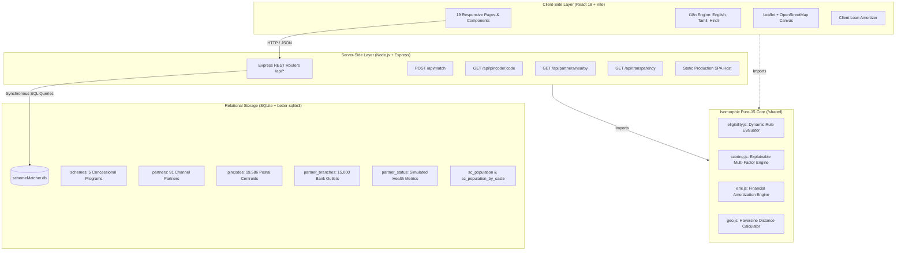
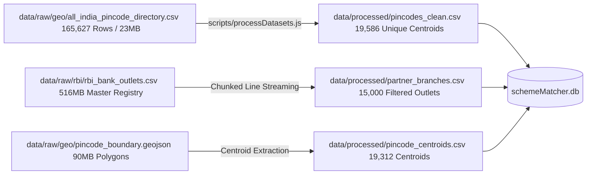

# SchemeMatcher (SIH26092) – Comprehensive Technical Project Report

**Project Title:** SchemeMatcher: AI-Driven Concessional Scheme Matching Platform for Marginalized Entrepreneurs  
**Problem Statement ID:** SIH26092  
**Domain:** Public Welfare Technology, Inclusive Financial Architecture, Digital Governance  
**Target Beneficiaries:** Scheduled Caste (SC) Entrepreneurs, Youth, Women Self-Help Groups, and Artisans  

---

## 1. Executive Summary & Abstract

Marginalized entrepreneurs and students in India often fail to utilize concessional credit programs offered by the **National Scheduled Castes Finance and Development Corporation (NSFDC)** due to complex institutional guidelines, lack of transparency in eligibility conditions, and difficulty identifying authorized regional disbursement channels.

**SchemeMatcher** solves this challenge through an accessible, deterministic, and transparent digital public-service platform. Built upon an isomorphic full-stack architecture (React 18 + Node.js/Express + SQLite), the platform integrates over **19,000 postal PIN codes**, **15,000 banking outlets**, **91 accredited channel partners**, and **Census 2011 demographic baselines**.

### Key Technical Contributions:
1. **Deterministic Rule-Based Eligibility Engine:** Evaluates scheme-specific income ceilings, project cost caps, applicant categories, and loan ratios without black-box opacity.
2. **Multi-Factor Explainable Scoring (0–100 Points):** Weights interest rate concession (30 pts), loan fit (25 pts), repayment tenor (20 pts), moratorium grace periods (15 pts), and purpose alignment (10 pts), providing clear mathematical explanations for every recommendation.
3. **Geospatial Proximity Locator:** Integrates Leaflet and OpenStreetMap tiles with automated radius expansion (25km → 50km → 250km → 500km) and postal centroid resolution.
4. **Comprehensive Financial Amortization Engine:** Accurately computes monthly EMIs, handles interest-only moratorium grace periods, and generates complete month-by-month repayment schedules.
5. **Multi-Lingual Inclusivity & Strict Data Governance:** Native trilingual interface (**English**, **Tamil**, **Hindi**), dynamic typography controls, and explicit data disclaimers distinguishing official norms from simulated research metrics.

---

## 2. System Architecture

### Architectural Highlights:
- **Zero Heavy Dependencies:** Synchronous, low-latency SQLite access via `better-sqlite3` ensures sub-10ms response times on consumer hardware.
- **Isomorphic Code Sharing:** Core mathematical models (`eligibility.js`, `scoring.js`, `emi.js`) are pure JavaScript modules executed identically in Node.js and the React client.
- **Fail-Safe Offline Capability:** The complete application, database, and postal centroid index operate in fully local, air-gapped environments without mandatory internet access.

---

## 3. Data Engineering & Processing Pipeline

The project implements a strict data governance framework: **original source data in `data/raw/` is permanently read-only and never modified**. All transformations are executed via automated streaming scripts producing verified outputs in `data/processed/`.

### Dataset Provenance & Registry Summary:
1. **NSFDC Schemes (`schemes.csv`):** 5 verified schemes including Micro Finance Scheme (MFS), Term Loan (TL), Educational Loan Scheme (ELS), Aajeevika Microfinance Yojana (AMY), and Udyam Nidhi Yojana (UNY).
2. **Channel Partners (`nsfdc_partners.csv`):** 91 institutions classified into State Channelising Agencies (SCAs), Public Sector Banks (PSBs), and Regional Rural Banks (RRBs).
3. **Partner Coordinates (`partner_geo.csv`):** Verified administrative locality coordinates.
4. **Simulated Status (`partner_status.csv`):** 91 simulated records containing NPA levels, overdue rates, and fund utilization percentages (explicitly labeled: *"Simulated data – not live government information"*).
5. **Postal Directory (`all_india_pincode_directory.csv`):** 165,627 raw post office records deduplicated into 19,586 unique postal centroids.
6. **Census 2011 SC Demographics:** 881 state and caste records serving as historical planning benchmarks.

---

## 4. Core Algorithms & Mathematical Formulations

### 4.1. Dynamic Eligibility Formulation
For a candidate applicant with Annual Income $I$, Estimated Project Cost $C$, and Requested Loan Amount $L$, evaluating Scheme $S$:

$$\text{Eligible}(I, C, L, S) = \begin{cases} 
\text{True} & \text{if } I \le S_{\text{income\_cap}} \land C \le S_{\text{max\_cost}} \land L \le L_{\text{max}} \land \text{CatMatch} \\
\text{False} & \text{otherwise}
\end{cases}$$

Where the maximum allowable loan $L_{\text{max}}$ is defined by:
$$L_{\text{max}} = \min\left(S_{\text{max\_loan}}, \left\lfloor C \times \frac{S_{\text{cap\_percent}}}{100} \right\rfloor\right)$$

### 4.2. Explainable 5-Factor Scoring Formulation (Max: 100 Points)
If $\text{Eligible} = \text{False}$, then $\text{Score} = 0$.  
If $\text{Eligible} = \text{True}$, the total score is computed deterministically across 5 transparent dimensions:

$$\text{Total Score} = S_{\text{interest}} + S_{\text{coverage}} + S_{\text{tenor}} + S_{\text{moratorium}} + S_{\text{purpose}}$$

1. **Interest Rate Concession ($S_{\text{interest}} \in [0, 30]$):**
   $$S_{\text{interest}} = \text{round}\left( \max\left(0, \min\left(1, \frac{16.0 - R}{16.0 - 5.0}\right)\right) \times 30 \right)$$
   *(Where $R$ is the scheme's annual interest rate in percent)*

2. **Loan Coverage Fit ($S_{\text{coverage}} \in [0, 25]$):**
   $$S_{\text{coverage}} = \text{round}\left( \min\left(1, \frac{L_{\text{max}}}{L}\right) \times 25 \right)$$

3. **Repayment Tenor Score ($S_{\text{tenor}} \in [0, 20]$):**
   $$S_{\text{tenor}} = \min\left(20, \text{round}\left(\frac{Y}{10} \times 20\right)\right)$$
   *(Where $Y$ is repayment duration in years)*

4. **Moratorium Grace Score ($S_{\text{moratorium}} \in [0, 15]$):**
   $$S_{\text{moratorium}} = \min\left(15, \text{round}\left(\frac{M}{12} \times 15\right)\right)$$
   *(Where $M$ is moratorium duration in months)*

5. **Sector & Purpose Alignment ($S_{\text{purpose}} \in [5, 10]$):**
   $$S_{\text{purpose}} = \begin{cases} 10 & \text{if scheme matches user sector directly} \\ 5 & \text{for general multi-sector enterprise} \end{cases}$$

### 4.3. Financial Amortization with Moratorium
Let $P$ be principal, $r = \frac{R}{100 \times 12}$ be monthly interest rate, $N = Y \times 12$ total months, and $M$ moratorium months.
- **During Moratorium ($m \in [1, M]$):**  
  Principal repayment is suspended. Monthly simple interest serviced:
  $$\text{Payment}_m = P \times r, \quad \text{Principal Paid} = 0$$
- **Post-Moratorium Amortization ($m \in [M+1, N]$):**  
  Amortized across remaining $k = N - M$ months:
  $$\text{EMI} = P \times \frac{r(1+r)^k}{(1+r)^k - 1}$$

### 4.4. Geospatial Haversine Distance Formula
Given user location $(\phi_1, \lambda_1)$ and partner location $(\phi_2, \lambda_2)$ in radians:
$$\Delta\phi = \phi_2 - \phi_1, \quad \Delta\lambda = \lambda_2 - \lambda_1$$
$$a = \sin^2\left(\frac{\Delta\phi}{2}\right) + \cos(\phi_1)\cos(\phi_2)\sin^2\left(\frac{\Delta\lambda}{2}\right)$$
$$d = 2 R_{\text{earth}} \arctan\left(\frac{\sqrt{a}}{\sqrt{1-a}}\right) \quad (R_{\text{earth}} = 6371\text{ km})$$

---

## 5. Verification & Testing

The platform includes an automated Vitest test suite executing 19 unit and integration tests across 5 test suites:
- `tests/eligibility.test.js` (6 tests): Validates approval of eligible applicants, boundary income rejections, project cost rejections, loan cap rejections, and general category handling.
- `tests/scoring.test.js` (4 tests): Validates that ineligible schemes receive 0 points, confirms lower interest rates earn higher points, verifies coverage ratios, and checks breakdown array structure.
- `tests/emi.test.js` (4 tests): Verifies standard EMI calculations, moratorium principal suspensions, zero handling, and end-of-tenure zero closing balances.
- `tests/geo.test.js` (2 tests): Verifies zero distance on identical points and accurate calculation between known coordinates (Bengaluru to Chennai: ~290 km).
- `tests/datasets.test.js` (3 tests): Verifies raw dataset integrity and processed files.

---

## 6. Project Impact & Conclusion

SchemeMatcher demonstrates that digital public welfare platforms can be made **both technically sophisticated and ethically transparent**. By eliminating black-box algorithms, providing trilingual accessibility, and connecting spatial postal coordinates directly to accredited financial institutions, the platform bridges the last-mile gap between marginalized entrepreneurs and government credit support.
