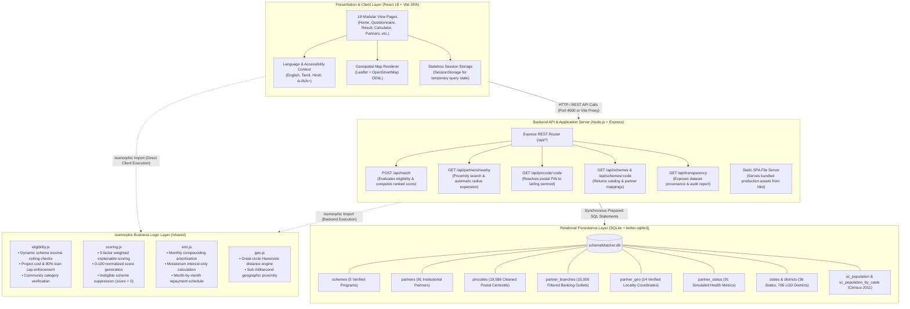
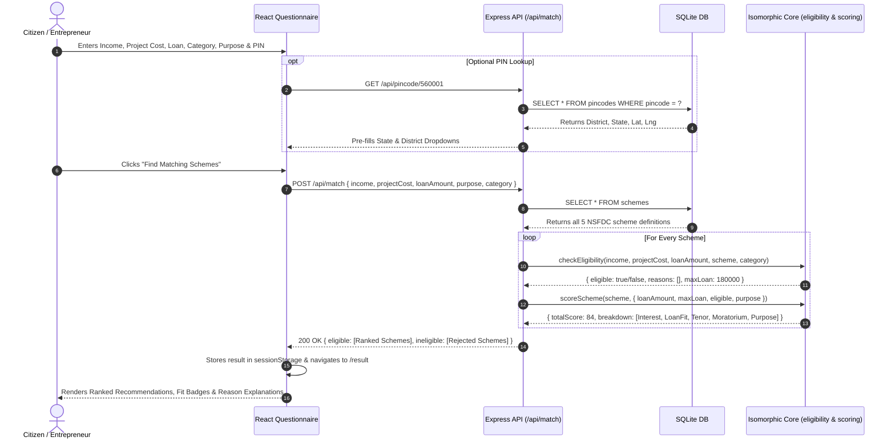
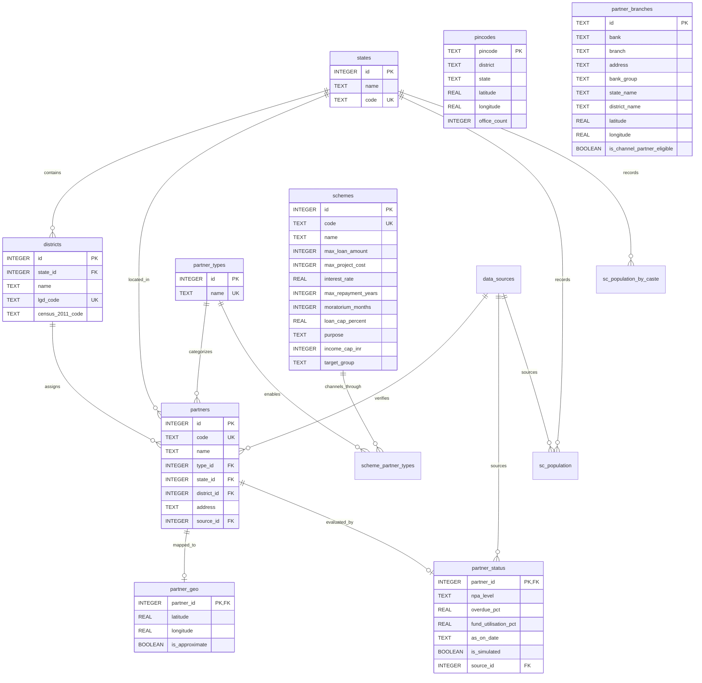

# SchemeMatcher (SIH26092) – System Architecture Specification

---

## 1. High-Level Component & Tier Architecture

---

## 2. End-to-End Evaluation Sequence Flow

---

## 3. Database Entity-Relationship (ER) Diagram

